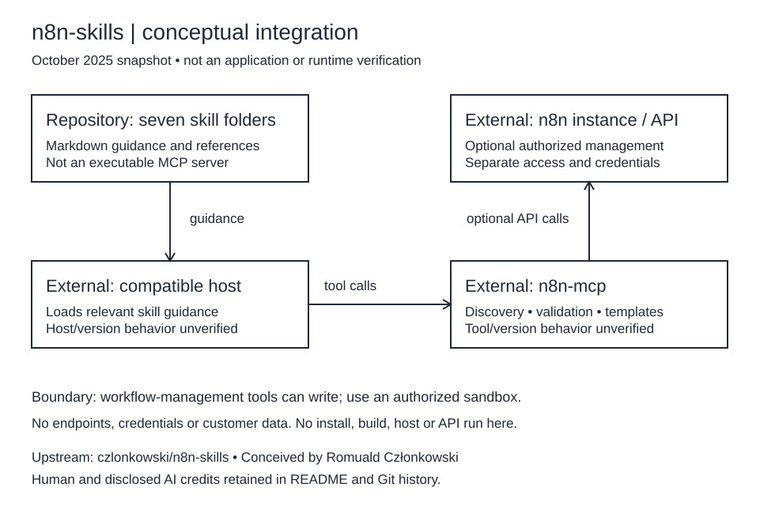

# n8n-skills

**A credited snapshot of Claude skills for n8n-mcp workflow guidance**

## Source and scope

This repository preserves the upstream [czlonkowski/n8n-skills snapshot at
`ec350daa6e148733ddb7d0c74b25c8dc69879b12`](https://github.com/czlonkowski/n8n-skills/tree/ec350daa6e148733ddb7d0c74b25c8dc69879b12)
(latest commit dated October 21, 2025). Before this documentation cleanup,
`JDKristenson/n8n-skills` had that exact same default-branch commit: no tree delta
relative to **that upstream revision**, not a comparison with upstream today.
Repository namespace does not establish authorship or a GitHub fork relationship.
The local changes described here clarify documentation and add an editable diagram;
they do not implement new skills or claim original authorship of the collection.
This documentation cleanup is AI-assisted (Reason), separate from the historical
Claude disclosures for the upstream work.

The bounded history reachable from that snapshot has 21 commits dated October
20–21, 2025, attributed to `czlonkowski` / Romuald Członkowski; 13 commit messages
include Claude co-authorship disclosures. Those records do not resolve every
person's contribution or independently establish how the content was produced.
Preserve upstream, human, community and disclosed AI credits when reusing it.

This is a Markdown skills/reference collection, **not a standalone n8n application**.
Installation and runtime compatibility have **not been run or verified** during
this cleanup. Numerical claims, success rates, platform instructions and runtime
examples below are inherited October 2025 guidance, not current measurements or
guarantees; consult current host, n8n and n8n-mcp documentation before use.

[](LICENSE)
[](https://github.com/czlonkowski/n8n-mcp)

---

## 🎯 What is this?

This repository contains 7 complementary **Claude Code skills** that teach AI assistants how to build production-ready n8n workflows using the [n8n-mcp](https://github.com/czlonkowski/n8n-mcp) MCP server.

### Why These Skills Exist

Building n8n workflows programmatically can be challenging. Common issues include:
- Using MCP tools incorrectly or inefficiently
- Getting stuck in validation error loops
- Not knowing which workflow patterns to use
- Misconfiguring nodes and their dependencies

These skills solve these problems by teaching Claude:
- ✅ Correct n8n expression syntax ({{}} patterns)
- ✅ How to use n8n-mcp tools effectively
- ✅ Proven workflow patterns from real-world usage
- ✅ Validation error interpretation and fixing
- ✅ Operation-aware node configuration

---

## 📚 The 7 Skills

### 1. **n8n Expression Syntax**
Teaches correct n8n expression syntax and common patterns.

**Activates when**: Writing expressions, using {{}} syntax, accessing $json/$node variables, troubleshooting expression errors.

**Key Features**:
- Core variables ($json, $node, $now, $env)
- **Critical gotcha**: Webhook data is under `$json.body`
- Common mistakes catalog with fixes
- When NOT to use expressions (Code nodes!)

### 2. **n8n MCP Tools Expert** (HIGHEST PRIORITY)
Expert guide for using n8n-mcp MCP tools effectively.

**Activates when**: Searching for nodes, validating configurations, accessing templates, managing workflows.

**Key Features**:
- Tool selection guide (which tool for which task)
- nodeType format differences (nodes-base.* vs n8n-nodes-base.*)
- Validation profiles (minimal/runtime/ai-friendly/strict)
- Smart parameters (branch="true" for IF nodes)
- Auto-sanitization system explained

**Most Important**: Teaches correct MCP tool usage patterns and parameter formats

### 3. **n8n Workflow Patterns**
Build workflows using 5 proven architectural patterns.

**Activates when**: Creating workflows, connecting nodes, designing automation.

**Key Features**:
- 5 proven patterns (webhook processing, HTTP API, database, AI, scheduled)
- Workflow creation checklist
- Real examples from 2,653+ n8n templates
- Connection best practices
- Pattern selection guide

### 4. **n8n Validation Expert**
Interpret validation errors and guide fixing.

**Activates when**: Validation fails, debugging workflow errors, handling false positives.

**Key Features**:
- Validation loop workflow
- Real error catalog
- Auto-sanitization behavior explained
- False positives guide
- Profile selection for different stages

### 5. **n8n Node Configuration**
Operation-aware node configuration guidance.

**Activates when**: Configuring nodes, understanding property dependencies, setting up AI workflows.

**Key Features**:
- Property dependency rules (e.g., sendBody → contentType)
- Operation-specific requirements
- AI connection types (8 types for AI Agent workflows)
- Common configuration patterns

### 6. **n8n Code JavaScript**
Write effective JavaScript code in n8n Code nodes.

**Activates when**: Writing JavaScript in Code nodes, troubleshooting Code node errors, making HTTP requests with $helpers, working with dates.

**Key Features**:
- Data access patterns ($input.all(), $input.first(), $input.item)
- **Critical gotcha**: Webhook data under `$json.body`
- Correct return format: `[{json: {...}}]`
- Built-in functions ($helpers.httpRequest(), DateTime, $jmespath())
- Top 5 error patterns with solutions (covering 62%+ of failures)
- 10 production-tested patterns

### 7. **n8n Code Python**
Write Python code in n8n Code nodes with proper limitations awareness.

**Activates when**: Writing Python in Code nodes, need to know Python limitations, working with standard library.

**Key Features**:
- **Important**: Use JavaScript for 95% of use cases
- Python data access (_input, _json, _node)
- **Critical limitation**: No external libraries (requests, pandas, numpy)
- Standard library reference (json, datetime, re, etc.)
- Workarounds for missing libraries
- Common Python patterns for n8n

---

## 🚀 Installation

### Prerequisites

**Historical setup examples — NOT RUN.** Plugin commands below target upstream,
not this credited snapshot. They may install a different revision. Host interfaces,
SDKs and n8n behavior can change; these are not verified current instructions.
See the [setup status and boundaries](docs/INSTALLATION.md#setup-status-and-boundaries).

1. **n8n-mcp MCP server** installed and configured ([Installation Guide](https://github.com/czlonkowski/n8n-mcp))
2. **Claude Code**, Claude.ai, or Claude API access
3. `.mcp.json` configured with n8n-mcp server

### Claude Code

**Method 1: Plugin Installation** (Recommended)
```bash
# Install directly as a Claude Code plugin
/plugin install czlonkowski/n8n-skills
```

**Method 2: Via Marketplace**
```bash
# Add as marketplace, then browse and install
/plugin marketplace add czlonkowski/n8n-skills

# Then browse available plugins
/plugin install
# Select "n8n-mcp-skills" from the list
```

**Method 3: Manual Installation**
```bash
# 1. Clone this repository
git clone https://github.com/czlonkowski/n8n-skills.git

# 2. Copy skills to your Claude Code skills directory
cp -r n8n-skills/skills/* ~/.claude/skills/

# 3. Reload Claude Code
# Skills will activate automatically
```

### Claude.ai

1. Download individual skill folders from `skills/`
2. Zip each skill folder
3. Upload via Settings → Capabilities → Skills

### API / SDK

See [docs/INSTALLATION.md](docs/INSTALLATION.md) for detailed instructions.

---

## 💡 Usage

Skills activate **automatically** when relevant queries are detected:

```
"How do I write n8n expressions?"
→ Activates: n8n Expression Syntax

"Find me a Slack node"
→ Activates: n8n MCP Tools Expert

"Build a webhook workflow"
→ Activates: n8n Workflow Patterns

"Why is validation failing?"
→ Activates: n8n Validation Expert

"How do I configure the HTTP Request node?"
→ Activates: n8n Node Configuration

"How do I access webhook data in a Code node?"
→ Activates: n8n Code JavaScript

"Can I use pandas in Python Code node?"
→ Activates: n8n Code Python
```

### Skills Work Together

When you ask: **"Build and validate a webhook to Slack workflow"**

1. **n8n Workflow Patterns** identifies webhook processing pattern
2. **n8n MCP Tools Expert** searches for webhook and Slack nodes
3. **n8n Node Configuration** guides node setup
4. **n8n Code JavaScript** helps process webhook data with proper .body access
5. **n8n Expression Syntax** helps with data mapping in other nodes
6. **n8n Validation Expert** validates the final workflow

All skills compose seamlessly!

---

## 📖 Documentation

- [Installation Guide](docs/INSTALLATION.md) - Detailed installation for all platforms
- [Usage Guide](docs/USAGE.md) - How to use skills effectively
- [Development Guide](docs/DEVELOPMENT.md) - Contributing and testing
- [MCP Testing Log](docs/MCP_TESTING_LOG.md) - Historical observations dated October 20, 2025
- [Integration diagram](docs/skill-context.svg) - Conceptual boundaries, not a running app
- [Editable Excalidraw source](docs/skill-context.excalidraw) - Open/import in Excalidraw; preview uses the same shapes and labels



---


## 🧪 Testing

The source contains **32 JSON evaluation scenarios** across seven skill groups.
These specify expected behavior; they are not recorded passing test results.
There is no application package manifest, lockfile, automated evaluation runner or
native build command in this snapshot. Do not infer an `npm test` or build setup.
The [development guide](docs/DEVELOPMENT.md) describes evaluation-driven work and
an automated framework as future work.

For future manual evaluation, use a separately configured compatible host, run a
scenario with and without the relevant skill, and record host/model/n8n-mcp/n8n
versions and observed versus expected behavior. Workflow-writing scenarios need a
sandbox and explicit permission. **No host, MCP, n8n API or scenario was run here.**

---

## 🤝 Contributing

Contributions welcome! Please see [DEVELOPMENT.md](docs/DEVELOPMENT.md) for guidelines.

### Development Approach

1. **Evaluation-First**: Write test scenarios before implementation
2. **MCP-Informed**: Test tools, document real responses
3. **Iterative**: Test against evaluations, iterate until 100% pass
4. **Concise**: Keep SKILL.md under 500 lines
5. **Real Examples**: All examples from real templates/tools

---

## 📝 License

The root [MIT license](LICENSE) names Copyright (c) 2025 Romuald Członkowski.
Retain its copyright and permission notice in copies or substantial portions.
Preserve applicable nested/community notices too; this declaration does not
relicense external n8n, n8n-mcp, host software or independently sourced templates.
See the [distribution notice status](dist/README.md#notice-status) before reusing
individual ZIPs. Archives were inspected, not rebuilt by this cleanup.

---

## 🙏 Credits

**Conceived by Romuald Członkowski**
- Website: [www.aiadvisors.pl/en](https://www.aiadvisors.pl/en)
- Part of the [n8n-mcp project](https://github.com/czlonkowski/n8n-mcp)

---

## 🔗 Related Projects

- [n8n-mcp](https://github.com/czlonkowski/n8n-mcp) - MCP server for n8n
- [n8n](https://n8n.io/) - Workflow automation platform

---

## 📊 What's Included

- **7** complementary skills that work together
- **525+** n8n nodes supported
- **2,653+** workflow templates for examples
- **10** production-tested Code node patterns
- **Comprehensive** error catalogs and troubleshooting guides

---

**Ready to build flawless n8n workflows? Get started now!** 🚀
